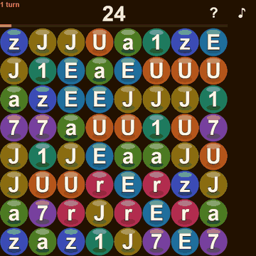
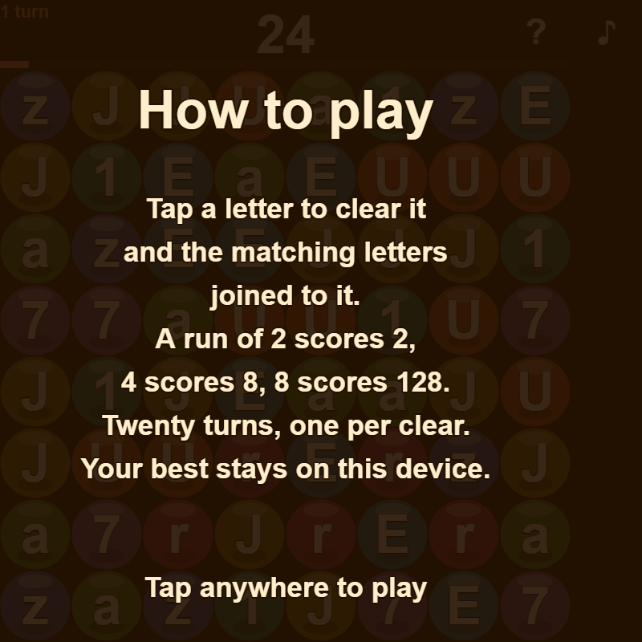
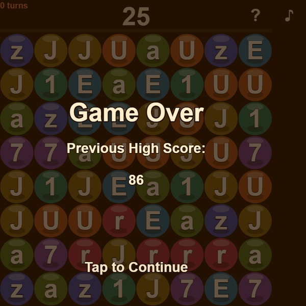

# Text Crush

A word board you tap. Tap a letter to clear it together with every letter connected to it, and the
tiles above fall down to fill the gap.

**Play it:** <https://kevinelong.github.io/textcrush/> — it installs to a phone home screen
(Share → Add to Home Screen on iOS, or the install prompt on Android) and then runs offline.

## What it looks like

The board, with the score, the turns in their own colour, and a bar that drains as they go. A tap
clears the letter and every match joined to it; the tiles above fall in and the score counts up
rather than jumping:


The last turn of a game, the end card arriving, the prompt pulsing, and the next board being dealt:







Every image here is a capture of the game running, not a mock-up.

## How it plays

- The board is 8×8, drawn from 8 distinct letters and digits.
- **Tap a tile** to clear it and every tile joined to it (up, down, left, right) with the same
  character.
- **Scoring** is `2^(n-1)` for a run of `n`: one tile is 1 point, two is 2, three is 4, eight is 128.
  A turn is spent whatever the size, so the game rewards one big group over five small ones.
- **Twenty turns**, then it is over. The high score is kept on your device.

## Layout

```
source/web/          the page: canvas, click pipeline, service worker, manifest, icons
source/game/classes/ the game: TypeScript sources next to the JavaScript the page loads
alt/tc.py            an early Python sketch of the model. It has drifted from the game and is not a
                     reference: its scoring is 2^(n-1) written in Python, which is XOR, not the
                     exponent the game uses
test/                the game's rules: node test/game-rules.test.js, no dependencies
tools/               stage-site.sh (builds the published site), check-live-site.sh (is the published
                     site this checkout?), make_pwa_icons.py
docs/STATE.md        where this repository stands, and what is waiting to be pushed
```

## Run it locally

```sh
sh tools/stage-site.sh
python -m http.server 8020 --directory build/site
# open http://127.0.0.1:8020/
```

`tools/stage-site.sh` is the single definition of the published layout — GitHub Pages runs the same
script (`.github/workflows/pages.yml`), so a local check and the live site are assembled identically.
`sh tools/check-live-site.sh` asks the live site whether it is serving this checkout.

Editing the TypeScript needs a compiler; the JavaScript beside it is generated output:

```sh
npx -y -p typescript@5 tsc -p tsconfig.json
```

The rules are pinned by `node test/game-rules.test.js`, which loads the same shipped JavaScript the
page does: the clear and what is connected, the scoring table from a run of one to a run of eight,
one turn per clear, twenty turns, the fall after a clear, and a game in progress surviving a round
trip through storage. It needs nothing installed, and `.github/workflows/test.yml` runs it on every
push — the only other workflow here publishes the site, so nothing tested the game before.

## Android and iOS

The same game is wrapped as an Android app in
[kevinelong/textcrush-android](https://github.com/kevinelong/textcrush-android) (APK downloads,
verified on an emulator). The mobile wrappers bundle this source and serve it to a WebView.

## License

Functional Source License, Version 1.1, MIT Future License (`FSL-1.1-MIT`) — see
[LICENSE.md](LICENSE.md). Use, copy, modify and redistribute it freely, including commercially,
except to build a competing product or service; two years after each release the license becomes
plain MIT.
